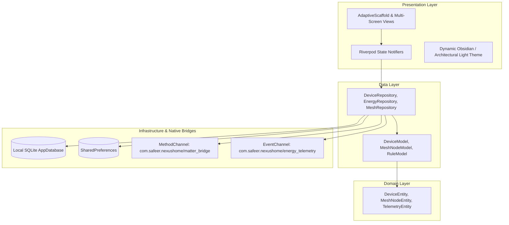
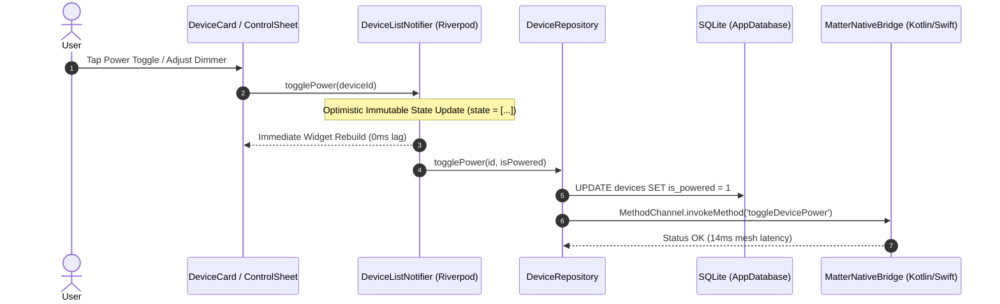
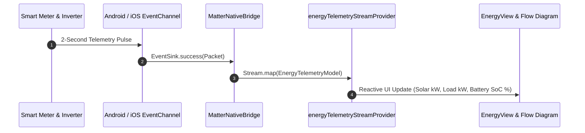

# NexusHome

[](https://github.com/Safeer-Hussain/nexushome/actions/workflows/ci.yml)
[](https://flutter.dev)
[](https://dart.dev)
[](#system-architecture)
[](#confidentiality--clean-room-disclaimer)

NexusHome is an architectural Smart Home IoT Automation Ecosystem, Matter/Thread Mesh Network Controller, Real-Time Solar & Energy Grid Telemetry Platform, Native IoT Hardware Bridge, and On-Device AI Home Copilot engineered in Flutter.

Designed for high-performance zero-cloud residential sanctuaries, NexusHome operates completely offline via an edge-first SQLite database and native Android (Kotlin) and iOS (Swift) platform channels.

---

## System Architecture

NexusHome enforces a strict Feature-First Clean Architecture + MVVM design pattern:



---

## State Flow & Reactive Mutations



---

## Native Matter / Thread Mesh Telemetry Flow



---

## Core Feature Matrix

| Feature Module | Technical Specification | Operational State |
| :--- | :--- | :--- |
| **Room Floorplan Hub** | Filterable by Living Room, Master Suite, Kitchen, Office, Garage with explicit `mainAxisExtent: 145` | Production Ready |
| **Device Control Studio** | Brightness (0-100%), Kelvin temperature (2700K-6500K), HVAC thermostat dial (16°C-30°C), PIN-protected deadbolt | Production Ready |
| **Thread Mesh Canvas** | CustomPainter topology graph, pulsing Border Router node, hop counts, dBm signal diagnostics | Production Ready |
| **Matter Commissioning** | 11-digit Matter pairing code validator, quick-discovery beacon shortcuts, instant node generation | Production Ready |
| **Solar & Grid Analytics** | Directional power bus, full-width `fl_chart` 24h diurnal dual-line chart, USD / PKR tariff calculator | Production Ready |
| **Automations & Scenes** | One-tap quick scenes ("Good Morning", "Cinema Mode", "Eco Saver"), IF-THEN rule builder | Production Ready |
| **Security Sentinel** | Armed Home / Armed Away / Disarmed states, live camera cards, PIR motion event stream | Production Ready |
| **On-Device AI Copilot** | Contextual power auditor, token streaming guarded in `try ... finally`, one-tap efficiency prompts | Production Ready |
| **EV Smart Charger (Level 2)** | Dynamic 6A-32A current slider, battery SoC gauge, off-peak tariff scheduler (23:00-06:00), fast-charge boost override | Production Ready |
| **Circadian Adaptive Engine** | Astronomical solar elevation angle solver, 2700K-5500K smooth cubic curve, 15-min periodic batch Thread node dispatch | Production Ready |
| **Recruiter Debug Drawer** | Latency simulator (100-1500ms), HTTP 503 cloud outage toggle, motion trigger injection | Production Ready |

---

## Quality Gate & Verification

The project includes a standalone gatekeeper script `tool/sprint_gate.dart`:

```bash
dart run tool/sprint_gate.dart
```

This sequentially enforces:
1. `flutter pub get`
2. `dart format lib test tool`
3. `flutter analyze --no-fatal-infos --no-pub`
4. `flutter test --no-pub`
5. Connected Android physical device runtime check (`adb logcat -d` for RenderFlex or duplicate Hero tags).

---

## Confidentiality & Clean-Room Disclaimer

This software and its documentation are developed under a clean-room protocol for Safeer Hussain. All architectural patterns, mock network interceptors, Matter platform bridges, and AI Copilot engines are original implementations utilizing open standards.
