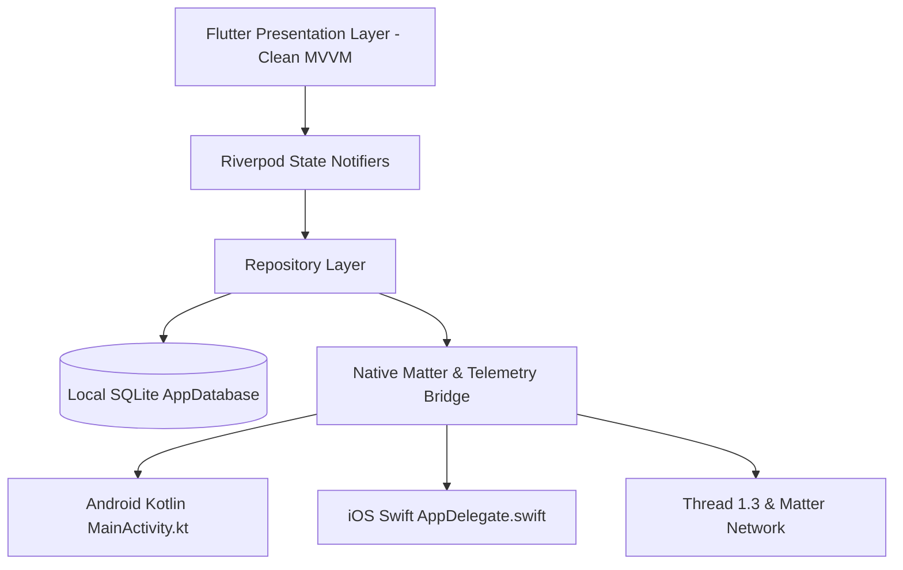

# NexusHome Product Requirements Document (PRD)

## 1. Executive Summary & Product Vision
NexusHome is a flagship enterprise Smart Home IoT Automation Ecosystem, Matter/Thread Mesh Network Controller, Real-Time Solar & Energy Grid Telemetry Platform, Native IoT Hardware Bridge, and On-Device AI Home Copilot engineered in Flutter.

Designed for high-performance residences and zero-cloud private sanctuaries, NexusHome operates completely offline via an edge-first SQLite database and native Android (Kotlin) / iOS (Swift) platform channels. It coordinates Thread 1.3 border routers, Matter over Wi-Fi luminaires, smart locks, climate units, solar inverters, and battery storage without relying on external cloud endpoints or recurring SaaS subscriptions.

---

## 2. Target Persona & Core Problems
### Primary Personas
1. **Architectural Homeowner & Sustainability Enthusiast**: Requires granular monitoring of rooftop solar generation, home battery state of charge (SoC), dynamic tariff schedules, and automated energy shedding.
2. **IoT Security & Privacy Purist**: Demands 100% offline data storage, biometric deadbolt validation, and zero telemetry leaks to big-tech servers.
3. **Smart Home Engineer / Integrator**: Requires visual Thread mesh topology exploration, dBm signal diagnostics, hop counts, and pairing flows conforming to Matter 1.3 standards.

---

## 3. System Architecture & Tech Stack

### Core Technologies
- **Framework**: Flutter 3.47+ / Dart 3.13+
- **Architecture**: Feature-First Clean Architecture + MVVM (`core/`, `data/`, `domain/`, `presentation/`)
- **State Management**: Flutter Riverpod 2.6+ (`StateNotifier`, `ProviderScope`)
- **Dependency Injection**: GetIt 8.3+
- **Offline Persistence**: SQLite (`sqflite` & `sqflite_common_ffi`), `shared_preferences`
- **Native Platform Channels**:
  - `MethodChannel('com.safeer.nexushome/matter_bridge')`
  - `EventChannel('com.safeer.nexushome/energy_telemetry')`
- **Telemetry Visualizations**: `fl_chart` 0.70+ with edge-to-edge full width rendering
- **Connectivity Monitoring**: `connectivity_plus`

---

## 4. Database Schema Specifications

### `devices` Table
| Column | Type | Description |
| :--- | :--- | :--- |
| `id` | TEXT PRIMARY KEY | Unique hardware node identifier (`dev_*`) |
| `name` | TEXT | Human-readable device label |
| `room` | TEXT | Zone (Living Room, Master Suite, Kitchen, Home Office, Solar Garage) |
| `type` | TEXT | `light`, `hvac`, `lock`, `blinds`, `sensor`, `router` |
| `protocol` | TEXT | `Thread 1.3`, `Matter over Wi-Fi`, `BLE Mesh` |
| `is_powered` | INTEGER | 1 = ON, 0 = OFF |
| `brightness` | INTEGER | Dimmer scale 0 - 100% |
| `color_temp` | INTEGER | Kelvin temperature 2700K - 6500K |
| `target_temp`| REAL | Climate thermostat target 16.0°C - 30.0°C |
| `current_temp`| REAL | Ambient room temperature read from sensor |
| `hvac_mode` | TEXT | `cool`, `heat`, `eco`, `auto`, `off` |
| `is_locked` | INTEGER | 1 = Locked, 0 = Unlocked |
| `position` | INTEGER | Motorized blinds open percentage 0 - 100% |
| `power_watts`| REAL | Instantaneous watt draw |
| `rssi` | INTEGER | Signal strength in dBm |
| `pairing_code`| TEXT | 11-digit Matter pairing code |
| `updated_at`| INTEGER | Unix epoch timestamp (ms) |

### `mesh_nodes` Table
| Column | Type | Description |
| :--- | :--- | :--- |
| `id` | TEXT PRIMARY KEY | Node ID (`node_*`) |
| `device_id` | TEXT | Foreign reference to associated device |
| `node_name` | TEXT | Label displayed in canvas topology |
| `node_type` | TEXT | `border_router`, `router`, `end_device` |
| `protocol` | TEXT | Transport protocol |
| `rssi` | INTEGER | Signal dBm |
| `hop_count` | INTEGER | Routing distance from Border Router (0, 1, 2) |
| `status` | TEXT | `active`, `degraded`, `offline` |
| `x_pos` | REAL | Normalized relative horizontal position (0.0 - 1.0) |
| `y_pos` | REAL | Normalized relative vertical position (0.0 - 1.0) |
| `updated_at`| INTEGER | Timestamp |

### `automation_rules` Table
| Column | Type | Description |
| :--- | :--- | :--- |
| `id` | TEXT PRIMARY KEY | Rule ID (`rule_*`) |
| `title` | TEXT | Rule name |
| `trigger_type`| TEXT | Trigger event |
| `trigger_value`| TEXT | Event parameter |
| `action_type`| TEXT | Execution target |
| `action_target`| TEXT | Target zone or device |
| `is_enabled` | INTEGER | 1 = Active, 0 = Paused |
| `created_at` | INTEGER | Timestamp |

---

## 5. Functional Requirements Matrix
- **REQ-1 (Floorplan Hub)**: 1-tap power toggle, dynamic room filter, rich modal control sheets with sliders and PIN protection.
- **REQ-2 (Mesh Canvas)**: Visual canvas with `CustomPainter`, pulsing border router, live dBm signal strength, self-healing diagnostics.
- **REQ-3 (Energy Analytics)**: Directional power flow, 24h dual-line diurnal chart, currency conversion (USD/PKR), JSON telemetry export.
- **REQ-4 (Automation & Security)**: One-tap scenes ("Good Morning", "Away & Armed", "Cinema Mode", "Eco Peak Saver"), IF-THEN rule engine, live sentinel timeline.
- **REQ-5 (On-Device AI Copilot)**: Real-time contextual query handling, token streaming with `try ... finally` guarantees, one-tap prompt shortcuts.
- **REQ-6 (Physical Device Protection)**: Android SDK 36 compatibility, disabled Impeller Vulkan crash flag for Mali GPUs, safe 800x360 landscape layout.
